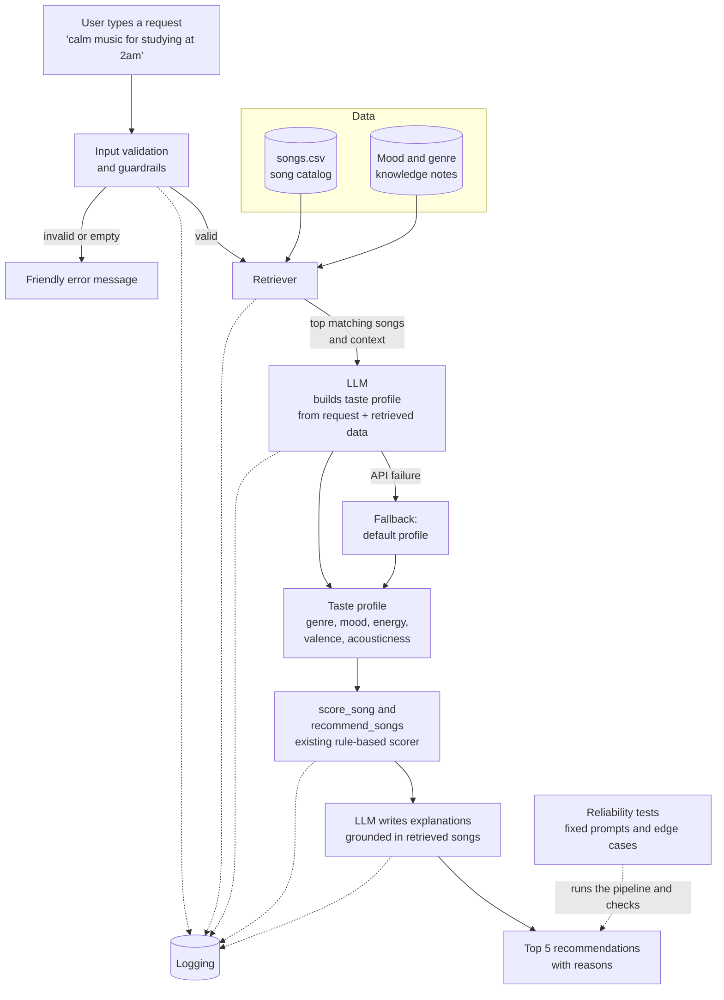

# System Diagram, Version 1

Planned architecture: RAG music concierge with a reliability layer.

## Flow summary

1. The user describes what they want in plain language.
2. Guardrails validate the input.
3. The retriever finds relevant songs and mood notes from the data.
4. The LLM uses the retrieved data to build a taste profile.
5. The existing scorer ranks songs against that profile.
6. The LLM explains each pick using only the retrieved song data.
7. Every step is logged, and a test script checks the pipeline for consistency.
